# AI Code Evaluator & Automated Lab Tutor
## Comprehensive AI-Powered Programming Learning and Placement Platform

[](https://spring.io/projects/spring-boot)
[](https://www.oracle.com/java/)
[](https://reactjs.org/)
[](https://groq.com/)
[](LICENSE)

An enterprise-grade, full-stack AI platform designed for university computer science laboratories, automated coding evaluation, personalized student mentoring, placement preparation, and faculty automation.

---

## 🌟 Architecture & System Diagram

```mermaid
graph TD
    User[Student / Faculty] --> WebUI[React 18 + Vite UI]
    WebUI --> API[Spring Boot 3.2 REST API]
    API --> Security[Spring Security + JWT]
    
    subgraph "Execution & AI Core"
        API --> Execution[Execution Engine: Docker + Local Sandbox]
        API --> GroqAI[Groq LLM Engine: llama-3.3-70b-versatile]
        API --> MemoryEngine[Module 16: AI Memory Engine]
    end

    subgraph "Student Growth & Placement Engine"
        API --> Mod1[Module 1: Learning Path Generator]
        API --> Mod2[Module 2: Adaptive Question Generator]
        API --> Mod3[Module 3: AI Viva Examiner]
        API --> Mod4[Module 4: Debugger Replay]
        API --> Mod5[Module 5: Learning Analytics]
        API --> Mod6[Module 6: Complexity Analyzer]
        API --> Mod7[Module 7: Placement Readiness Score]
        API --> Mod8[Module 8: AI Pair Programming Assistant]
        API --> Mod10[Module 10: AI Skill Graph]
        API --> Mod11[Module 11: AI Voice Mentor]
        API --> Mod12[Module 12: AI Revision Notes Generator]
        API --> Mod15[Module 15: AI Lab Report Generator]
        API --> Mod17[Module 17: AI Interview Simulator]
        API --> Mod18[Module 18: AI Project Reviewer]
    end

    subgraph "Faculty & Institutional Integrity"
        API --> Mod9[Module 9: AI Plagiarism Detection]
        API --> Mod13[Module 13: AI Edge Case Generator]
        API --> Mod14[Module 14: AI Faculty Assistant]
    end
```



---

## 🚀 18 Advanced GenAI Modules Breakdown

| Module | Priority | Complexity | Core Capabilities |
| :--- | :--- | :--- | :--- |
| **Module 1: AI Learning Path** | **High** | Medium | Generates dynamic study roadmaps and estimated hours (*e.g., 6 Hours*) based on weak areas. |
| **Module 2: Adaptive Question Generator** | **High** | High | Generates custom Easy/Medium/Hard coding problems tailored to student weaknesses without duplicates. |
| **Module 3: AI Viva Examiner** | **High** | Medium | Post-submission oral/written code defense evaluation (algorithm choice, complexity, edge cases). |
| **Module 4: Debugger Replay** | **High** | High | Step-by-step visual execution timeline (`i=0, sum=5 -> i=1, sum=8`) for failed program runs. |
| **Module 5: Learning Analytics** | **Medium** | Medium | Predicts interview readiness (%), problem-solving consistency, and monthly improvement velocity. |
| **Module 6: Complexity Analyzer** | **Medium** | Medium | Mathematical $O(N)$ time, space, and cyclomatic complexity audit (without giving code solutions). |
| **Module 7: Placement Readiness** | **Medium** | Medium | Scores placement readiness (%) and recommends target IT companies (**Zoho, TCS, Infosys, Cognizant, Hexaware**). |
| **Module 8: Pair Programmer** | **High** | Medium | Socratic conversational guide asking leading non-spoiler questions. |
| **Module 9: Plagiarism Detection** | **High** | High | Jaccard tokenized & Levenshtein AST structural similarity scanner for cohort submissions. |
| **Module 10: Skill Graph** | **Medium** | Low | Radar/progress chart tracking 10 core CS topics (*Arrays, Strings, Trees, DP, Recursion, etc.*). |
| **Module 11: Voice Mentor** | **Low** | High | Web Speech API integration supporting Speech Recognition & Text-to-Speech audio synthesis. |
| **Module 12: Revision Notes** | **Medium** | Low | Generates key concepts, formulas, common pitfalls, and interview checklists per topic. |
| **Module 13: Edge Case Generator** | **High** | Medium | Generates boundary, negative, empty, & stress test cases for faculty lab creation. |
| **Module 14: AI Faculty Assistant** | **High** | Medium | Reduces faculty workload by generating complete lab problems, Sample I/O, & Bloom's level. |
| **Module 15: Lab Report Generator** | **Low** | Low | Apache PDFBox downloadable lab completion performance report. |
| **Module 16: AI Memory Engine** | **Very High**| Medium | Tracks long-term recurring compiler/logic mistakes in SQLite DB ("*You made this same boundary error 12 days ago*"). |
| **Module 17: AI Interview Simulator** | **High** | High | Multi-round HR, Technical, Coding, and Resume interview simulator with scorecards. |
| **Module 18: AI Project Reviewer** | **High** | High | Audits full GitHub repositories for folder structure, code quality, design patterns, & security. |

---

## 🛠️ Technology Stack

### Backend Infrastructure
- **Framework**: Spring Boot 3.2.3 (Java 21 LTS)
- **Security**: Spring Security + JJWT (JSON Web Token authentication) + BCrypt Encryption
- **Database**: SQLite JDBC (`aievaluator.db`) with Hibernate Community Dialect
- **AI LLM Integration**: Groq LLM API (`llama-3.3-70b-versatile`) + OpenRouter fallback
- **Document Processing**: Apache PDFBox 3.0.1 for PDF resume text extraction and lab report generation
- **Documentation**: Springdoc OpenAPI Swagger UI at `/swagger-ui.html`

### Frontend Application
- **Framework**: React 18 + Vite
- **Styling**: Tailwind CSS + Lucide Icons
- **Code Editor**: Monaco Editor wrapper with support for **C**, **C++**, **Java**, and **Python**
- **Speech API**: Web Speech API (SpeechRecognition & SpeechSynthesis)

---

## 💻 How to Run Locally

### Prerequisites
- Node.js 18+ & npm
- JDK 21 LTS
- Apache Maven 3.9+

### Step 1: Clone Repository
```bash
git clone https://github.com/Aadhikesav07/AI-CODE-EVALUATOR-AUTOMATED-LAB-TUTOR.git
cd AI-CODE-EVALUATOR-AUTOMATED-LAB-TUTOR
```

### Step 2: Set Groq API Key (Optional for Live Groq LLM)
In PowerShell:
```powershell
$env:GROQ_API_KEY="gsk_your_groq_api_key_here"
```

### Step 3: Start Backend Server
```powershell
$env:PATH = "C:\Users\aadhi\.gemini\antigravity\apache-maven-3.9.8\bin;C:\Program Files\Eclipse Adoptium\jdk-21.0.12.8-hotspot\bin;" + $env:PATH
cd backend
mvn spring-boot:run
```
*(Backend runs on `http://localhost:8080`)*

### Step 4: Start Frontend Dev Server
Open a second terminal window:
```powershell
$env:PATH = "C:\Program Files\nodejs;" + $env:PATH
cd frontend
node "C:\Program Files\nodejs\node_modules\npm\bin\npm-cli.js" run dev
```
*(Frontend runs on `http://localhost:5173`)*

---

## 🔒 Security & Pedagogical Guardrails

- **Rule 1 (Non-Spoiler)**: AI hints and pair programmer interactions NEVER generate complete assignment code solutions.
- **Rule 2 (Test Case Integrity)**: Hidden test cases and faculty secrets are strictly guarded from prompt outputs.
- **Rule 3 (PII Scrubbing)**: Student email addresses and personal data are scrubbed before sending prompts to external APIs.

---

## 📄 License
Distributed under the MIT License. See `LICENSE` for more information.
